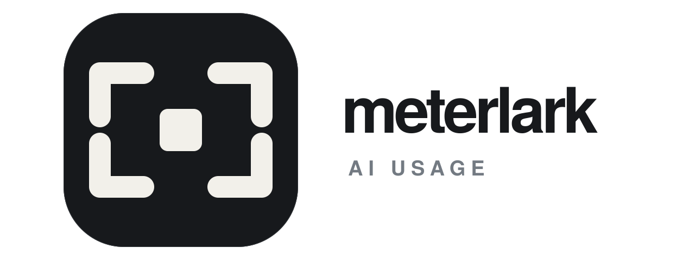
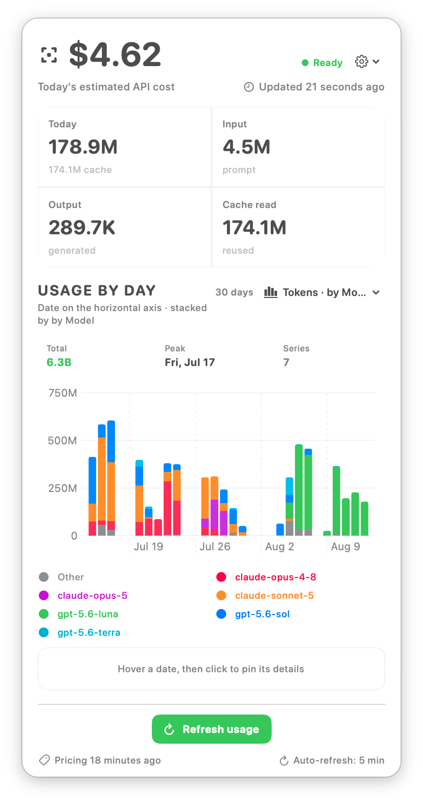
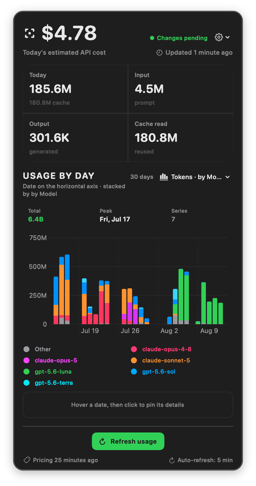
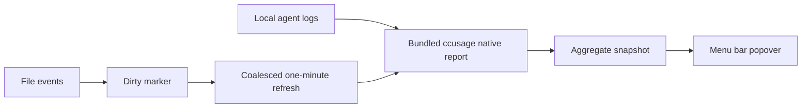

# Meterlark

<p align="center">
  
</p>

<p align="center">
  <strong>A quiet, local-first cost monitor for your AI coding agents.</strong><br>
  See today's API-equivalent spend, token flow, and model usage from the macOS menu bar.
</p>

<p align="center">
  
  
  
</p>

<div align="center">
  
  &nbsp;&nbsp;&nbsp;
  
</div>

<p align="center">
  <strong>LIGHT APPEARANCE</strong>&nbsp;&nbsp;&nbsp;&nbsp;&nbsp;&nbsp;&nbsp;&nbsp;<strong>DARK APPEARANCE</strong><br>
  <sub>Quiet contrast for daylight workflows&nbsp;&nbsp;&nbsp;&nbsp;&nbsp;&nbsp;&nbsp;&nbsp;Focused contrast for evening sessions</sub>
</p>

<p align="center">
  <sub>One local monitor, tuned for the way your day changes.</sub>
</p>

## Why it exists

Meterlark keeps AI coding usage, cost estimates, budgets, and provider information close at hand in the macOS menu bar. It combines local agent reports with optional external plugins in one customizable view:

- a small amount in the menu bar;
- an instant local snapshot when the popover opens;
- a single chart that can switch between Tokens/Cost and Agent/Model;
- hover details for the exact day and every underlying model;
- clear separation between known prices and unknown prices.

## Highlights

| | What you get |
| --- | --- |
| Local-first | Reads aggregate output from `ccusage`; prompts and responses never leave the machine through this app. |
| Multiple coding agents | Uses the unified `--by-agent --json` report, so new detected agent sources flow through the same view. |
| Usage by day | One compact chart with a readable `Tokens · by Agent` / `Cost · by Model` view selector. |
| Real detail on hover | Select a date to inspect total tokens, cost, agents, or every actual model behind the chart's `Other` bucket. |
| Low overhead | Coalesced file events mark data dirty; a configurable scheduler starts at most one usage refresh per interval, defaulting to one minute, while whole-month budget reconciliation runs independently at a lower cadence. Model-catalog refreshes use their own hours-to-days deadline and do not reprocess the full catalog on each usage watchdog tick. |
| Honest pricing | API-equivalent estimates are labelled; unmatched model prices stay visible as `Unknown`, and their tokens are excluded from known-cost totals and budgets with an explicit potentially-understated warning. |
| Budget guardrails | Optional daily and natural-month USD limits turn the primary amount and menu bar red and bold at a configurable threshold (80% by default); unknown-priced usage remains visible and is reported separately even when the threshold alert is active. |
| Personal workflow | English/中文/System language choice, Today/7/30/90-day or current-month lookback, and manual refresh controls. |
| Declarative plugins | Install trusted external providers that return host-validated metric grids, progress lists, or model catalogs; configure each plugin independently and place enabled plugin blocks in the host-owned Dashboard layout without loading plugin UI code. |

The external plugin package contract is documented in
[`docs/external-plugin.md`](docs/external-plugin.md). It supports a
manifest-only `http-json` transport for HTTPS JSON APIs and a `stdio-json`
transport for providers that require custom code. Only the latter is an
explicit local executable trust boundary; neither transport loads plugin UI
code.

## External plugins

Meterlark starts with no installed providers. Install a trusted `http-json` or
`stdio-json` package in **Settings → Plugins**, configure its endpoint and
credentials, and enable it explicitly. Secret fields are stored in macOS
Keychain. You can add enabled plugin blocks to the host-owned Dashboard layout.

For an HTTP plugin, choose **Paste JSON…**, paste the complete `plugin.json`,
and click **Install**. You can paste with the keyboard or use **Paste from
clipboard** in the editor. The manifest is validated before installation and
must be 512 KiB or smaller. Plugins with executable files use the package
directory installer.

Two optional templates live in [`Examples/Plugins/`](Examples/Plugins/):

| Example | Capability | Package |
| --- | --- | --- |
| Example Gateway | Cost metrics, quota progress, and JSON token refresh | [`Gateway`](Examples/Plugins/Gateway/) |
| Example Model Catalog | Source-aware model metadata and price schedules | [`ModelCatalog`](Examples/Plugins/ModelCatalog/) |

Their `example.test` endpoints are placeholders. Configure an API that implements
the documented response shape before using a template. Examples are not bundled
with the app. The [plugin development guide](docs/external-plugin.md) describes
requests, authentication, validation, configuration, and dashboard components.

Catalog refreshes use the pricing refresh interval and **Update pricing** action.
Catalog entries join custom prices in **Search models**; custom prices take
precedence. Catalog changes appear in the in-app notification feed.

## Supported harness agents

This source revision bundles `ccusage 20.0.32` and recognizes these local harness and agent sources. Meterlark consumes the unified `--by-agent --json` report, so a source appears when `ccusage` detects its local data:

- Claude Code
- Codex
- OpenCode
- Amp
- Droid
- Codebuff
- Hermes
- pi-agent
- Goose
- Kilo
- GitHub Copilot CLI
- Gemini CLI
- Kimi
- Qwen
- OpenClaw
- Grok Build CLI
- Antigravity
- ZCode

## Install

### Distribution

Download [Meterlark 1.2.11 for Apple Silicon](https://github.com/xingyu-shi/meterlark/releases/download/v1.2.11/Meterlark-1.2.11-arm64.zip),
unzip it, and move **Meterlark.app** to **Applications** (or `~/Applications`).
The release includes a [SHA-256 checksum](https://github.com/xingyu-shi/meterlark/releases/download/v1.2.11/Meterlark-1.2.11-arm64.zip.sha256).
See [all releases](https://github.com/xingyu-shi/meterlark/releases) and the
[version history](CHANGELOG.md) for changes.

To build from source, follow the steps below. The packaging script produces
`dist/Meterlark.app` and a versioned Apple Silicon ZIP in `dist/`.

Release downloads are signed with a Developer ID certificate and notarized by
Apple, so they open without a Gatekeeper warning. Source builds are ad-hoc
signed; on first launch, Control-click the app in Finder and choose **Open** if
macOS asks for confirmation.

### Prerequisites

- macOS 14 or newer
- Apple Silicon Mac for the current build
- Xcode 27 or newer with macOS SDK 27 or newer for source builds and packaging; the app still runs on macOS 14 or newer
- The packaged app includes its native reporting engine and needs no Node.js runtime.

For a source build, the pinned native binary is included at `Resources/ccusage`:

```sh
file Resources/ccusage
```

Build and install the menu-bar app:

```sh
git clone https://github.com/xingyu-shi/meterlark.git
cd meterlark
./scripts/install-user.sh
```

The app is installed at `~/Applications/Meterlark.app`. Open it from Finder, Spotlight, or Launchpad. No terminal needs to stay open.

A source build is ad-hoc signed and not notarized. If macOS blocks the first launch, Control-click the app in Finder and choose **Open**.

## Using it

Open the menu-bar amount and choose a view from the chart selector:

```text
Tokens · by Agent
Cost · by Model
```

The selector keeps both choices explicit. Hover a date to see the selected day's totals. When viewing by model, the chart may aggregate smaller series into `Other`; click that legend item or use the chart menu to expand the real model series, while the hover detail still lists the real models individually.

The settings button controls:

- automatic refresh interval after source changes: 30 seconds, 1, 5, or 15 minutes; manual refresh starts immediately;
- launch at login: off by default and configurable from Settings; macOS may require approval in System Settings → General → Login Items;
- lookback: Today, 7 days, 30 days, 90 days, or the current calendar month;
- theme: Automatic, Light, or Dark; Automatic is the default and follows macOS;
- surface style: Solid color or native macOS Frosted glass; Solid color is the default;
- interface text size: Standard, Large, Extra Large, and Largest at 100%, 110%, 120%, and 130%; larger presets use bounded layout adjustments, with Extra Large budget layouts at 985/995 points and Largest budget layouts at 1030/1040 points for one/both budgets;
- popover height: Compact is 780 points with no budget, 890 points with one configured budget, and 900 points with both budgets at Standard; a custom height from 400 to 2000 points is never changed by budget settings;
- menu bar format: defaults to `[logo]$[cost]`; use `[money:0]` for a compact four-corner frame with the amount in its center, `[money:0:plain]` or `[money:compact:plain]` to omit the currency symbol, while `[money:2]`, `[money:compact]`, and number-only `[cost]` tokens remain available. Adjacent text and cost tokens are rendered as one unit, so `$[cost:1]` does not add an artificial gap.
- optional daily and natural-month budget limits in USD; configure both limits and the alert threshold together in the Budget alerts window, which includes a normal/alert preview. The threshold is configurable from 1% to 100% and defaults to 80%. At the configured threshold of either limit, the primary amount, menu bar amount, and budget row use a red bold alert state. A monthly query is refreshed only while a monthly limit is configured; when the usage query explicitly covers the current calendar month, the budget row reuses that same total as the current-month summary, while shorter ranges use the latest daily-adjusted whole-month result. Whole-month reconciliation runs independently at a lower cadence and has a bounded wait during a continuous source-event storm. Missing or unknown-priced data is never presented as a zero-cost confirmation; unknown-priced tokens are excluded from the displayed total and budget, so those amounts may be understated until pricing is resolved.
- changing lookback refreshes the selected range with current pricing; if network pricing is unavailable, it falls back to the bundled offline pricing;
- optional LiteLLM-style custom price list; during a pricing refresh the active rates are translated into an app-owned ccusage config, while ccusage remains the single cost engine. An explicit finite `0` in the imported table means known-free `$0`; omitted, `null`, invalid, or unpriced values remain `Unknown`. The compatibility path supports one alternate tier, maps ordinary non-200K thresholds approximately to ccusage’s 200K tier, preserves the selected source and backend thresholds in the model detail, and marks multi-tier estimates as approximate;
- when a custom price list or an enabled remote model catalog is active, **Search models** in Settings → Pricing searches their union of source-aware model names, providers, routes, prices, limits, capabilities, and other preserved metadata; custom pricing wins over remote catalog pricing, and remote pricing wins over the existing ccusage/default result when the custom model is absent;
- incomplete pricing responses cannot silently replace a valid estimate with a near-zero amount;
- automatic pricing refresh is enabled by default once every 24 hours and can be disabled; failed automatic attempts also cool down for 24 hours, newly discovered providers are fetched immediately, and the 30-second usage watchdog never performs a full catalog refresh; manual **Update pricing** remains available immediately;
- import a LiteLLM-style custom price list with merge-first behavior: new model fields override matching fields, omitted fields and models are kept, and an explicit replace mode is available;
- export the active price list as a sorted LiteLLM-compatible JSON file for sharing;
- System, English, or 中文 interface language;

## How it works



Frequent usage refreshes ask `ccusage` to calculate both tokens and cost with `--offline` and the active app-owned pricing config; they do not fetch a new price table from the network. A pricing refresh is separate and bounded: it updates the price data used by later calculations, while lookback changes may fall back to bundled offline pricing. When a remote model catalog is enabled, its full projection, diff, and JSON encoding run only on a catalog refresh deadline (or an explicit manual update), not on the 30-second usage watchdog. Snapshots persist their query scope and custom-pricing revision so a cached result is never silently presented as a different range or price table. Snapshots are written atomically to:

```text
~/Library/Application Support/Meterlark/snapshot.json
```

The app stores aggregate usage, model, agent, period, the last trusted pricing result, and operational metadata only. It does not persist transcript text. Imported custom pricing is saved as an app-owned copy at `~/Library/Application Support/Meterlark/custom-pricing.json`; the generated ccusage compatibility config is stored separately at `~/Library/Application Support/Meterlark/ccusage-pricing.json`, and neither file modifies a user's original price list or ccusage config. Until the next pricing refresh, new tokens are reflected immediately while the displayed cost remains the last priced estimate; the UI shows when pricing was last updated.

### Uninstall and reset local state

The app has no separate uninstaller. To remove the app and its saved monitor state:

```sh
rm -rf "$HOME/Applications/Meterlark.app"
rm -rf "$HOME/Library/Application Support/Meterlark"
defaults delete com.xingyu.meterlark 2>/dev/null || true
```

This does not remove any Claude Code, Codex, or other agent session data. The bundled `ccusage` binary is replaced only when you intentionally update the app build; keep its version, hash, fixtures, and changelog entry synchronized.

## Build and test

```sh
swift test -c release --build-system native
swift build -c release --build-system native
./scripts/package-app.sh
```

The test suite includes decoder coverage, unknown-pricing behavior, localization, custom pricing import/export, menu bar format parsing and rendering, launch-at-login state decisions, and live integration tests against the bundled native `ccusage` binary.

## Project shape

```text
Sources/MeterlarkApp/
  MeterlarkApp.swift          Menu-bar entry point
  Views.swift                Popover, charts, hover details, localization-aware UI
  MonitorStore.swift         Refresh scheduling and application state
  CCUsageRunner.swift        Bounded bundled ccusage process runner
  Domain.swift               Reports, snapshots, and daily model aggregation
  SnapshotStore.swift        Atomic local persistence and source fingerprints
Tests/                       Decoder, localization, and live runner tests
```

## Privacy and pricing

This is a local monitor, not a billing authority. The displayed amount is an API-equivalent estimate calculated by the bundled `ccusage`; it is not a provider subscription invoice or an internal gateway bill. A model without a matching price is not silently treated as free.

The source bundle includes `ccusage 20.0.32`, licensed under MIT. See `Resources/THIRD_PARTY_NOTICES.txt`.

## Contributing

This is maintained as a personal project by [Xingyu Shi](https://github.com/xingyu-shi). Issues and focused pull requests are welcome. Please include the macOS version, Xcode version, `ccusage` version, and a redacted reproduction when reporting a problem.

Plugin authors should start with the [external plugin development guide](docs/external-plugin.md). It documents the installable package shape, `http-json` and `stdio-json` transports, configuration and secret handling, dashboard block contract, stable ID rules, and the validation workflow.

## License

No open-source license has been selected yet. Until one is added, the source remains available for review but is not automatically granted permission for reuse or redistribution.
